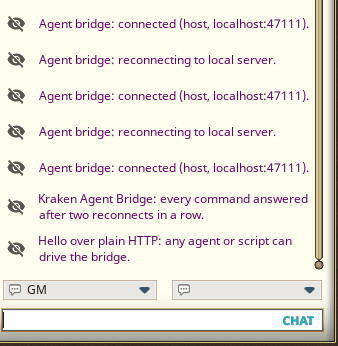

# Kraken Agent Bridge

**Let an AI agent read and drive your Fantasy Grounds Unity campaign.**

Kraken Agent Bridge is a Fantasy Grounds Unity (FGU) extension plus a small local server. With your campaign open, an agent can read and change the campaign database, open and read windows, press buttons, call ruleset Lua functions, roll through the ruleset's own actions, post to chat, reload the ruleset after you edit files, and read FGU's console. It works with **any ruleset** (CoreRPG, 5E, 3.5E, PFRPG, AD&D 2E, and others) and **any agent**:

- **MCP clients**: Claude Code, Claude Desktop, OpenAI Codex CLI, Gemini CLI, Cursor, VS Code, or anything else that speaks the Model Context Protocol. The bridge ships a standard stdio MCP server.
- **Everything else**: any program that can send HTTP to `127.0.0.1`, or run a command line. A script, a bot, or an agent without MCP can use the same commands.



*Formerly "Claude Bridge". It was always agent-agnostic underneath; the new name says so. Extensions written for the old name keep working.*

## What it's good for

- **Ruleset and extension developers:** edit your Lua or XML, have the agent `/reload`, read the console errors, and test the change in the running campaign.
- **Module builders:** check records, links and stats in bulk, fix fields, and add NPCs to the combat tracker to try them out.
- **GMs:** set up encounters, look things up, and roll from the sheets, with an assistant that sees what you see.
- **Automated tests:** run a ruleset's self-tests, build characters through a wizard, and compare sheets against the book.

## How it works

```text
 your agent ──MCP (stdio)──> fgu_mcp.py ──HTTP──> fgu_bridge_daemon.py <──polls── Kraken Agent Bridge (inside FGU)
 any script ──────────────── HTTP POST /cmd ────>   127.0.0.1:47111 only           runs the command, sends the result
```

FGU can't accept incoming connections, so the extension asks a local daemon for work. The extension keeps one request open, runs each command it gets, and sends the result back. The daemon listens on `127.0.0.1` only, never on your network. The MCP server starts the daemon by itself; you can also have it start with Windows.

FGU's Lua sandbox has no `loadstring`, so agents can't run arbitrary Lua. They use a fixed set of commands and call functions only in packages the bridge registers: FGU's API, CoreRPG's managers, common ruleset packages, and any package another extension registers.

## Quick start

1. Install Python 3.9 or newer (Windows). Nothing else is needed: the bridge uses only the standard library.
2. Download the release zip and copy its `KrakenAgentBridge` folder into `%APPDATA%\SmiteWorks\Fantasy Grounds\extensions\`.
3. Register the MCP server with your agent: a stdio server named `fgu` running `python "<that folder>\server\fgu_mcp.py"`. See [INSTALL.md](docs/INSTALL.md) for each agent's exact syntax.
4. In the FGU launcher, tick **Kraken Agent Bridge** for your campaign and start it. When FGU asks to open `http://127.0.0.1:47111/...`, click **Yes To All**.
5. The chat says **Agent bridge: connected (host, localhost:47111)**. Ask your agent to call `fgu_status`.

## Documentation

| Guide | What's in it |
| --- | --- |
| [INSTALL.md](docs/INSTALL.md) | Requirements, installing the extension, starting the daemon with Windows, connecting each agent, upgrading from Claude Bridge, uninstalling, troubleshooting |
| [USAGE.md](docs/USAGE.md) | Every tool and its arguments, recipes, GM and player roles, several FGU copies at once, the HTTP API, registering your extension's packages |
| [AGENT_GUIDE.md](docs/AGENT_GUIDE.md) | A guide written for the agent: hand it over, paste it into `AGENTS.md` or `CLAUDE.md`, or install it as the skill in `skills/fgu-bridge` |
| [CHANGELOG.md](CHANGELOG.md) | Version history |

## Tools at a glance

`fgu_status`, `fgu_db_get`, `fgu_db_list`, `fgu_db_set`, `fgu_db_create_child`, `fgu_db_delete`, `fgu_call`, `fgu_get`, `fgu_window_open`, `fgu_window_list`, `fgu_window_read`, `fgu_window_set`, `fgu_window_call`, `fgu_window_has`, `fgu_window_close`, `fgu_chat`, `fgu_slash`, `fgu_reload`, `fgu_chat_log`, `fgu_console`.

## Safety

- The daemon only listens on `127.0.0.1`. Other computers can't reach it.
- Any program on **your** computer can send it commands while a campaign with the extension is open, and those commands can change your campaign. Untick the extension when you don't want an agent connected, and back up campaigns you care about before letting an agent edit them.
- FGU asks you to allow the local URL once per launch. That prompt is your consent; agents should never click it for you.

## Requirements

- Windows 10 or 11. The core works anywhere FGU and Python run; typing chat commands (`fgu_slash`, `fgu_reload`) and window screenshots use Windows APIs.
- Fantasy Grounds Unity, any ruleset.
- Python 3.9 or newer. Pillow is optional, used only by the screenshot helper.

## Author

The Kraken ([krakenunbound](https://github.com/krakenunbound)). Other Fantasy Grounds extensions: [Kraken AD&D 2E Character Wizard](https://github.com/krakenunbound/kraken-adnd-2e-charwizard), [Kraken GM Icon](https://github.com/krakenunbound/kraken-gm-icon).
